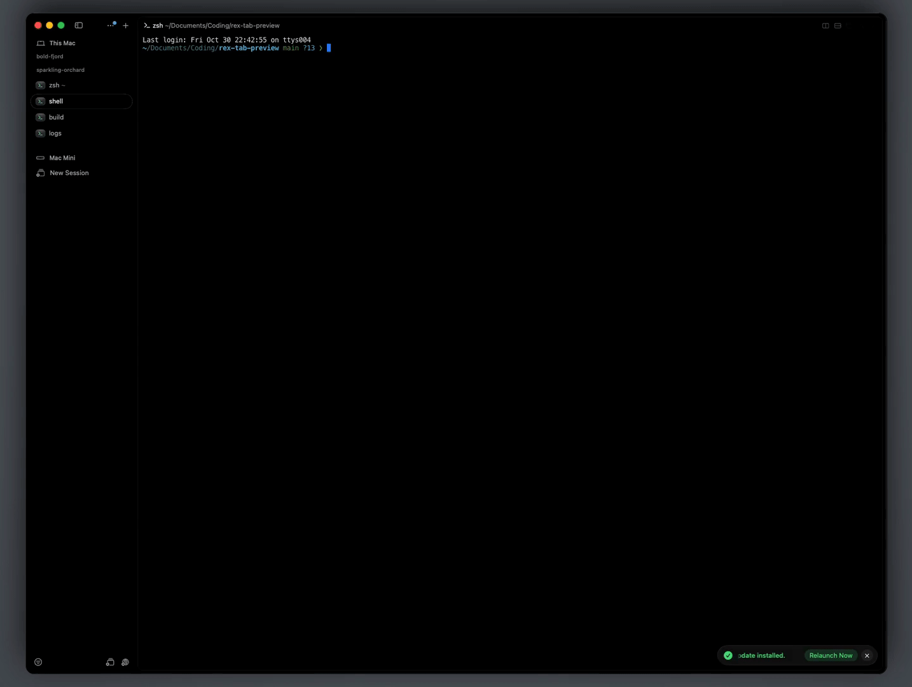

# rex-tab-preview

Preview another window's screen without leaving the one you're in. Press
`Cmd+P`, then a window number, and a small read-only copy of that window
appears next to the tab list. Press Enter to switch to it, or Escape to close
it. It needs only Rex and macOS.

[](demo.mp4)

Click the GIF for the video with sound.

## Shortcuts

| Keys | What it does |
| --- | --- |
| `Cmd+P`, then `1`–`9` | Preview window 1–9. Holding Cmd while pressing the digit also works. |
| `Enter` (preview open) | Switch to the previewed window, with a short pop sound. |
| `Escape` (preview open) | Close the preview and stay where you are. |

Enter and Escape only act on the preview while one is open. Otherwise they go
to the pane as normal. The preview refreshes every half second.

To use a different prefix than `Cmd+P`, pass it to `setup`, for example
`setup("cmd+shift+p")`.

## Install

Clone the repo anywhere. This example uses `~/.config/rex/rex-tab-preview`:

```sh
git clone https://github.com/WorldOccupier/rex-tab-preview ~/.config/rex/rex-tab-preview
```

Add this to `~/.config/rex/init.lua`:

```lua
package.path = os.getenv("HOME") .. "/.config/rex/rex-tab-preview/?.lua;" .. package.path
require("preview").setup()        -- or setup("cmd+shift+p")
```

Then run `rex config reload`.

## How it works

Rex has no tab-hover event and no layer styling API, so:

- the preview opens from a key press, not on hover;
- its border is drawn with box characters;
- its size is held fixed by snapping it back if it's moved or resized.

The previewed tab is marked with ◉ in the tab list.

Closing a preview runs the "Tab Preview Closed (internal)" action, which
shows up in the command palette. It does nothing when run by hand.
